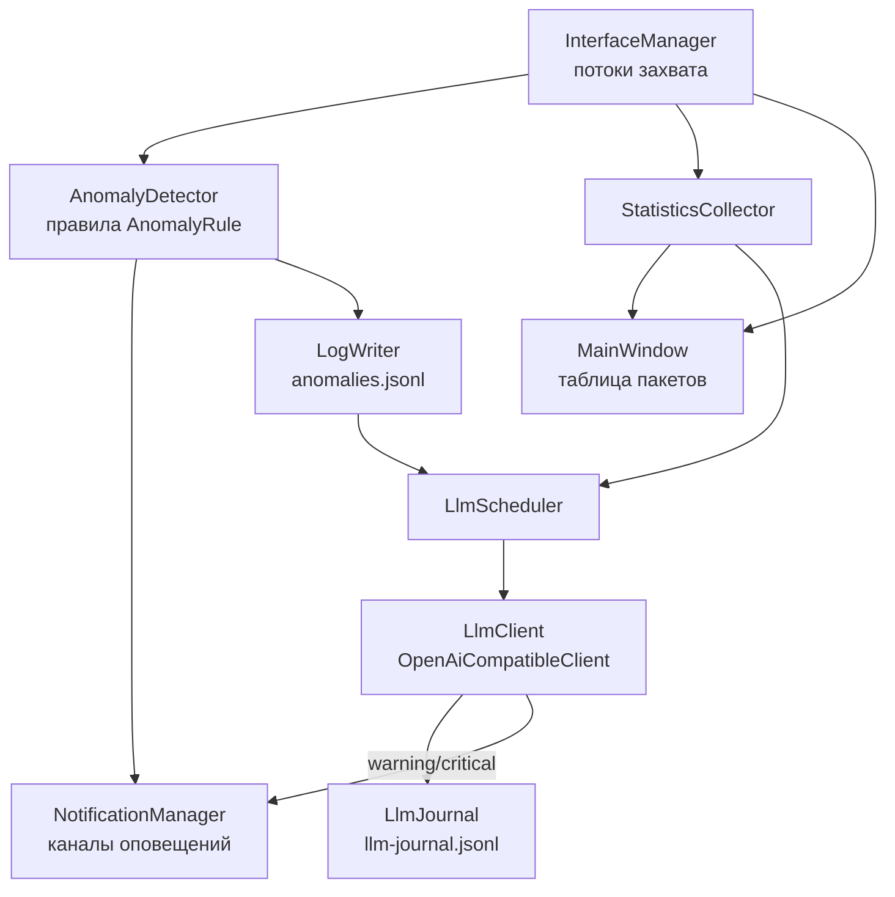

# Архитектура NetAnomalyAnalyzer

Документация для разработчиков: устройство проекта, потоки данных,
регламенты расширения. Пользовательское описание возможностей — в
`README.md`, руководство пользователя — в `help_src/manual.md` (оно же
встраивается в программу как справка).

## 1. Назначение и стек

NetAnomalyAnalyzer — приложение для Windows, анализирующее сетевые аномалии:
захват пакетов на сетевых интерфейсах, обнаружение аномалий по набору правил,
журналирование в JSONL, оповещения по каналам и опциональный интеллектуальный
анализ журналов во внешней LLM.

| Компонент | Выбор |
|---|---|
| Язык | C++17 |
| GUI | Qt 6 Widgets (проверено: Qt 6.8.3, MinGW 13.1 64-bit) |
| Захват трафика | pcap-совместимый API; на Windows — Npcap (`third_party/npcap`); без pcap работает демо-режим |
| Сборка | CMake ≥ 3.21, упрощающий скрипт `build.ps1` |
| LLM | любой OpenAI-совместимый HTTP-эндпоинт (адрес и модель — в настройках) |
| Служба | SCM API Windows (`advapi32`) |
| Справка | WinHelp (.hlp, формат HC31) и HTML, генерируются из одного исходника |

## 2. Структура репозитория

```
src/            исходный код (см. §4)
tools/          вспомогательные утилиты (генератор справки, автотесты, моки, скриншоты)
resources/      иконки, Qt-ресурсы (.qrc), сгенерированные артефакты справки
help_src/       manual.md — исходник руководства и справки
docs/           документация для разработчиков (этот файл)
third_party/    компоненты для размещения в системе (npcap)
build/          каталог сборки (создаётся CMake, не хранится в контроле)
logs/           журналы работы программы (создаётся при запуске)
```

## 3. Цели сборки (CMake)

| Цель | Тип | Назначение |
|---|---|---|
| `NetAnalyzerCore` | статическая библиотека | всё ядро: захват, правила, статистика, журналы, оповещения, LLM, настройки |
| `NetAnomalyAnalyzer` | GUI-приложение (WIN32) | графическая оболочка + Qt-ресурсы (`app.qrc`, `manual.qrc`) |
| `NetAnalyzerService` | консольная программа | ядро без GUI: консольный режим и служба Windows |
| `FilterTest` | автотест | проверки фильтров, сортировки, LLM-дедупликации и др. |
| `PcapSelfTest` | утилита | самодиагностика pcap (создаётся только при найденном pcap) |
| `HelpRegen` | custom target | пересборка справки из `help_src/manual.md` (нужен Python 3) |

`NetAnalyzerCore` линкуется только с `Qt6::Core` и `Qt6::Network`
(опционально с pcap; на Windows дополнительно `ws2_32`) и **не зависит от
QtWidgets**. Правило: функция, нужная и GUI, и службе, размещается в ядре.

`FilterTest` подключает часть исходников `src/ui` (таблицы, прокси, сортировщик),
проверяя и GUI-модели.

## 4. Структура каталогов `src/`

| Каталог | Содержимое |
|---|---|
| `app/` | `AppController` — создание и связывание подсистем |
| `core/` | модель пакета и парсер, движки захвата, интерфейсы, фильтры, группировка |
| `anomaly/` | правила обнаружения, детектор, статусы аномалий |
| `stats/` | `StatisticsCollector` |
| `logging/` | `LogWriter` (JSONL с ротацией) |
| `notify/` | `NotificationManager` и каналы оповещений |
| `llm/` | клиент LLM, планировщик, бюджет промпта, журнал, вердикты, дедупликация |
| `settings/` | `Settings` (обёртка над QSettings) |
| `ui/` | весь графический интерфейс |
| — | `main.cpp` (GUI), `service_main.cpp` (консоль/служба) |

## 5. Схема потоков данных

Связывание выполняется в `AppController::wireSubsystems()`:



1. `InterfaceManager` запускает по одному движку захвата на каждый выбранный
   интерфейс; сигналы всех движков объединяются в единый поток пакетов.
2. `AnomalyDetector` прогоняет каждый пакет через набор правил
   (`AnomalyRule::check()`); результат — объект `Anomaly`
   (уровни серьёзности: `Info` / `Warning` / `Critical`).
3. Найденные аномалии уходят: в `LogWriter` (`anomalies.jsonl`), в
   `NotificationManager` (рассылка по каналам с учётом фильтров) и в GUI
   (таблица «Аномалии»).
4. `StatisticsCollector` агрегирует счётчики по протоколам, узлам и
   интерфейсам — это данные вкладок «Статистика», «Группировка», временной
   шкалы и часть контекста для LLM.
5. `LlmScheduler` по таймеру или по запросу из интерфейса собирает контекст
   (статистика + новые аномалии со статусами + журнал событий с момента
   предыдущего запроса) и отправляет `LlmClient`; ответ разбирается в
   `LlmVerdict` и фиксируется в `LlmJournal`. Вердикт уровня warning/critical
   превращается в аномалию (правило «Анализ LLM»): она добавляется в список
   аномалий GUI, пишется в `anomalies.jsonl` и порождает оповещение
   (сигнал `verdictAnomaly`).
6. В GUI подключаются сигналы `NotificationManager::guiNotification()` и
   `alertSound()`; в консольном режиме они остаются неподключёнными —
   оповещения уходят только по настроенным каналам.

## 6. Модули ядра

### 6.1 Захват (`core/`)

- `ICaptureEngine` — базовый движок: `start()`/`stop()`, цикл в `std::thread`
  (`captureLoop` / `generateLoop`), сигнал `packetCaptured(Packet)`.
- `PcapCaptureEngine` — реальный захват: BPF-фильтры, promiscuous-режим;
  компилируется под `HAVE_PCAP`.
- `SimulationCaptureEngine` — симулятор трафика с воспроизведением аномалий
  (демо-режим без установленного pcap).
- `InterfaceManager` — список интерфейсов системы, запуск/остановка движков,
  объединение их сигналов.
- `Packet` / `PacketParser` — нормализованная модель пакета и разбор заголовков
  Ethernet/IPv4/IPv6/TCP/UDP/ICMP/ARP, полезной нагрузки, протокола приложения.
- `FilterCondition` / `PacketGrouper` — модель условий фильтрации и
  группировки (используются GUI-виджетами и автотестами).

### 6.2 Обнаружение (`anomaly/`)

- `AnomalyRule` — базовый интерфейс правила (Strategy): `name()`,
  `check(const Packet&)` → `std::optional<Anomaly>`, `reset()`.
- Готовые правила: `PortScanRule`, `SynFloodRule`, `UdpFloodRule`,
  `IcmpFloodRule`, `BroadcastStormRule`, `SuspiciousPortRule`,
  `PayloadSignatureRule`.
- `RateWindow` — скользящее окно частот для флуд-правил.
- `AnomalyDetector` — держит набор правил и порождает аномалии.
- `AnomalyStatusStore` — статусы «обнаружено» / «решено» (отметка
  оператора); ключ — `id@timestamp`, файл `<логи>/anomaly-status.json`.
  Статусы участвуют в фильтрах оповещений и в контексте LLM.

### 6.3 Статистика (`stats/`)

`StatisticsCollector` — счётчики пакетов/байт по протоколам, адресам и
интерфейсам; потребители — GUI и `LlmScheduler`.

### 6.4 Журналы (`logging/`)

`LogWriter` — запись JSON Lines с ротацией по размеру:

| Файл | Содержимое |
|---|---|
| `anomalies.jsonl` | обнаруженные аномалии (основной контекст для LLM) |
| `packets-ГГГГ-ММ-ДД.jsonl` | поток пакетов (по желанию, в настройках) |
| `notifications.jsonl` | отправленные оповещения (журнальный канал) |
| `errors.jsonl` | события и ошибки подсистем |

Каталог задаётся `LoggingSettings::logDir` (по умолчанию `logs/`).
Отдельно: `llm-journal.jsonl` (журнал запросов LLM) и служебные файлы
состояния (§9).

### 6.5 Оповещения (`notify/`)

- `Notifier` — интерфейс канала: `channelName()`, `isEnabled()`,
  `isJournalChannel()`, `notify(const Anomaly&)`, сигнал `sent()`.
- Каналы: `LogNotifier` (журнал `notifications.jsonl` — всегда, минуя
  фильтры), `TelegramNotifier`, `WebhookNotifier`, `EmailNotifier`
  (собственный SMTP-клиент на QtNetwork: SSL/TLS, STARTTLS, AUTH LOGIN).
- `NotificationManager` — рассылка по всем каналам с учётом настроек:
  минимальный уровень серьёзности и исключение аномалий, отмеченных
  «решено»; GUI-сигналы `guiNotification()` / `alertSound()`.

### 6.6 LLM (`llm/`)

- `LlmClient` — интерфейс запроса; `OpenAiCompatibleClient` — реализация
  для OpenAI-совместимых API (адрес, модель, таймауты — из `LlmSettings`;
  сетевые запросы асинхронные, на сигналах Qt).
- `PromptBudget` — укладка контекста в бюджет токенов; пакет аномалий
  делится на чанки так, что каждая аномалия попадает ровно в один чанк.
- `LlmSentStore` — защита от повторной отправки: ключ `id@timestamp`,
  файл `<логи>/llm-sent.json` (до 5000 ключей, старые вытесняются).
  Отметка «отправлено» ставится **после успешного ответа** (для чанков —
  после каждого успешного чанка); при ошибке запроса аномалии уходят
  повторно. Полный сброс — удалить файл.
- `LlmScheduler` — планировщик: собирает контекст, шлёт по таймеру
  (`LlmSettings::interval`) либо вручную (`requestManualAnalysis()`,
  `sendTestRequest()`); уже отправленные аномалии в контекст не попадают,
  а пропуски отражаются в промпте («Новых аномалий нет: N…»).
- Контракт ответа модели: строго JSON-объект
  `{"status":"ok|warning|critical","data":{...}}`; разбор — `LlmVerdict`.
- `LlmJournal` / `LlmJournalEntry` — журнал запросов и ответов
  (`llm-journal.jsonl`, вкладка «Журнал LLM»).
- Переопределения окружения: `NETANALYZER_LLM_URL`, `NETANALYZER_LLM_MODEL`.

### 6.7 Настройки (`settings/`)

`Settings` — синглтон над `QSettings`; хранилище — ini-файл
`<каталог конфигурации>/<имя приложения>.ini` (см. `openSettings()`,
`configDir()`, `settingsFilePath()`): Windows — `%ProgramData%\NetAnalyzer\`,
Linux — `/etc/netanalyzer` (переопределение — переменная окружения
`NETAN_CONFIG_DIR`). Каталог журналов по умолчанию (`defaultLogDir()`):
Windows — `%ProgramData%\NetAnalyzer\logs`, Linux — `/var/log/netanalyzer`.
При первом запуске на Windows настройки мигрируют из старого реестрового
хранилища (`HKCU\Software\NetAnalyzer\NetAnomalyAnalyzer`). Структуры:
`InterfaceSettings`, `CaptureSettings`, `DetectionSettings`,
`LlmSettings`, `NotificationSettings`, `LoggingSettings`. `reload()`
вызывается до создания `AppController` (и в `main.cpp`, и в `service_main.cpp`).

### 6.8 Контроллер (`app/`)

`AppController` создаёт подсистемы, связывает их сигналами
(`wireSubsystems()`) и отдаёт их оболочкам через геттеры. Не зависит от GUI.

## 7. Графическая оболочка (`src/ui/`)

- `MainWindow` — единое окно: панель управления захватом, вкладки
  «Пакеты», «Аномалии», «Статистика», «Группировка», «Просмотр логов»,
  «Журнал LLM», «Настройки»; системный трей, оповещения, клавиша F1.
- Таблицы и модели: `PacketTableModel`, `PacketFilterProxy`,
  `AnomalyTableModel`, `LlmJournalModel`, `TableSorter`, `FilterDialog`,
  `PacketDetailsDialog`.
- Виджеты анализа: `StatsWidget`, `GroupingWidget`, `TimelineWidget`,
  `TimeSeriesWidget`, `ProtocolBarWidget`, `LogViewerWidget`.
- Настройки: `SettingsWidget` с вкладками «Интерфейсы», «Правила аномалий»,
  «LLM», «Оповещения», «Журналирование».
- `HelpDialog` — встроенное окно справки: две колонки (закреплённое
  оглавление слева, прокручиваемый текст справа). `openSmart()`
  предпочитает WinHlp32 с `help/netanalyzer.hlp`, иначе показывает HTML
  из Qt-ресурсов.

В GUI — только отображение и подписки на сигналы ядра; бизнес-логика
остаётся в `NetAnalyzerCore`.

## 8. Консольная/служебная оболочка (`service_main.cpp`)

```
(без аргументов)   захват, журналы, оповещения, LLM-расписание
--no-capture       не запускать захват (журналы и LLM работают)
--run-for <сек>    завершиться через указанное число секунд
--help, -h         справка
--install          установить службу NetAnalyzerService (автозапуск)
--uninstall        удалить службу
--service          режим работы внутри SCM (запускает служба)
```

Управление службой: `sc start|stop|query NetAnalyzerService`.
GUI-сигналы не подключаются; для службы журналы пишутся рядом с executable.

## 9. Потоки и файлы состояния

**Потоки.** Каждый движок захвата работает в собственном `std::thread`.
Объекты ядра принадлежат потоку, который их создал; данные из потоков
захвата передаются только через сигналы Qt (cross-thread — queued-соединения),
поэтому GUI трогается исключительно в главном потоке. Вкладка «Группировка»
читает журнал `packets-*.jsonl` в собственном `std::thread` (одна задача за
раз; результат доставляется в GUI queued-lambda с проверкой номера задачи,
при росте файла дозагружаются только новые байты) — интерфейс не блокируется
даже на многогигабайтных журналах. Сетевые клиенты
(HTTP/SMTP) асинхронны; тестовый `StubLlmClient` в автотестах намеренно
синхронный — при расширении `LlmScheduler` учитывать reentrancy
(обновление состояния — до отправки следующего чанка).

**Файлы состояния в `logs/`:**

| Файл | Назначение |
|---|---|
| `anomaly-status.json` | статусы «решено» (`AnomalyStatusStore`) |
| `llm-sent.json` | отметки «отправлено в LLM» (`LlmSentStore`) |
| `llm-journal.jsonl` | журнал запросов LLM (`LlmJournal`) |

## 10. Сборка и запуск

```powershell
# упрощённый путь (находит CMake/Qt, собирает цели, запускает автотесты)
powershell -ExecutionPolicy Bypass -File build.ps1

# вручную
cmake -B build
cmake --build build
```

- Qt и MinGW должны быть в PATH (для проверенной конфигурации:
  `C:\Qt\6.8.3\mingw_64\bin`, `C:\Qt\Tools\Tools\mingw1310_64\bin`).
- CMake ищет pcap (на Windows — в том числе в `third_party/npcap`); без
  него цель `PcapSelfTest` не создаётся, а приложение собирается с
  демо-режимом (без `HAVE_PCAP`).
- Перед перелинковкой останавливать запущенные экземпляры целей
  (`Stop-Process -Name NetAnomalyAnalyzer, FilterTest, NetAnalyzerService`).

## 11. Тестирование

- **`FilterTest`** (`build/FilterTest.exe`) — основной автотест: операции над
  `Packet` и JSON-записями, прокси-модель таблиц, сортировка, группировка,
  бюджет промпта, агрегация вердиктов, фильтры оповещений, дедупликация
  отправки в LLM. Успех: код возврата 0 и строка `ALL PASSED`.
  Использует изолированную регистрацию (организация `NetAnalyzerTest`,
  приложение `FilterTest`) и `QTemporaryDir` — безопасен параллельно с
  рабочим приложением. Длинный вывод удобно писать в файл
  (`Start-Process -RedirectStandardOutput`).
- **`NETANALYZER_SMTP_TEST=1`** — добавляет проверку почты через локальный
  тестовый SMTP-сервер (`tools/mock_smtp_server.py`, 127.0.0.1:2525).
- **`PcapSelfTest`** — список интерфейсов и короткий захват (при наличии pcap).
- **Моки**: `tools/mock_llm_server.py` (127.0.0.1:8765),
  `tools/mock_smtp_server.py` (127.0.0.1:2525),
  `tools/service_ctrl_test.py` — проверка службы.
- **Снимки окон**: `tools/screenshot_window.ps1`,
  `tools/screenshot_by_title.ps1` (PrintWindow — работает и без активного
  рабочего стола).

## 12. Справка

- Исходник: `help_src/manual.md`. Разметка минимальная:
  `## id = Заголовок` — тема, `###` — подзаголовок, `- ` — список,
  `[[id|текст]]` — ссылка на тему, `**жирный**` — выделение (в HTML).
- Генератор `tools/build_help.py` создаёт:
  - `resources/netanalyzer.hlp` — настоящий WinHelp (проверяется
    `tools/hlp_probe.py` и внешним декомпилятором формата);
  - `resources/manual.html` — одной страницей (предпросмотр в браузере);
  - `resources/manual_toc.html` / `resources/manual_body.html` — две колонки
    для встроенного окна справки.
- Интеграция: `resources/manual.qrc` (HTML в exe), POST_BUILD-копия
  `help/netanalyzer.hlp` рядом с программой, цель `HelpRegen`,
  кнопка «Справка» / F1 / `--show-help` → `HelpDialog::openSmart()`.
- **Правило**: после правки `manual.md` выполнить `tools/build_help.py`
  (или цель `HelpRegen`) и пересобрать приложение.

## 13. Регламенты расширения

### Новое правило обнаружения

1. Класс-наследник `AnomalyRule` в `src/anomaly/` (реализовать `name()`,
   `check()`, `reset()`).
2. Добавить файлы в `CORE_SOURCES` (`CMakeLists.txt`).
3. Пороги и списки — в `DetectionSettings` и на виджете
   `DetectionSettingsWidget` (вкладка «Правила аномалий»).
4. Прогнать `FilterTest`; при необходимости добавить проверки в
   `tools/filter_test.cpp`.

### Новый канал оповещения

1. Наследник `Notifier` в `src/notify/`.
2. Подключить в `NotificationManager` и добавить настройки в
   `NotificationSettings` + `NotificationSettingsWidget`.
3. Добавить файлы в `CORE_SOURCES`.

### Новая настройка

1. Поле в соответствующей структуре `Settings.h`, чтение/запись в
   `Settings.cpp` (через `QSettings`).
2. Виджет на вкладке `SettingsWidget`.
3. При необходимости — применение на лету (перезапуск захвата, таймер LLM)
   через `AppController`.

### Новая тема справки

1. Строка `## id = Заголовок` в `help_src/manual.md` (и ссылка `[[id|…]]`
   из других тем, если тема должна попасть в навигацию).
2. Пересобрать: `python tools/build_help.py` (или цель `HelpRegen`).
3. Проверить `--check` и открыть справку в программе (F1).

### Новый журнал

Писать через `LogWriter` (единый формат JSONL и ротация); для отображения —
подключить к `LogViewerWidget` (вкладка «Просмотр логов»).

## 14. Соглашения по коду

- Один класс — один файл, файл называется по имени класса (`.h` / `.cpp`).
- Doxygen-комментарии к классам и публичным методам; язык — русский.
- Связи между подсистемами — сигналами и слотами Qt, не прямыми вызовами.
- Строки интерфейса — через `tr()`, русский язык.
- Документация — деловой стиль, без сравнений с другим ПО.
- В ядро не вводить зависимости от QtWidgets.
- Настройки — только через `Settings`, состояние — через файлы в `logs/`.
